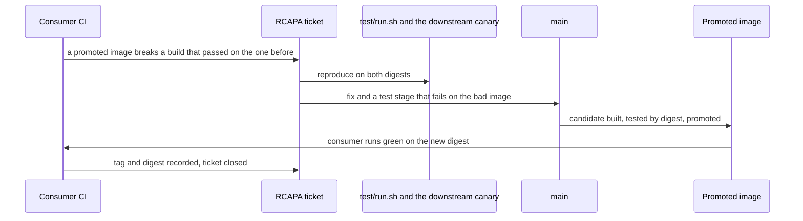

# RCAPA: regressions in a release of swarm-routing/ns3-containers

An **RCAPA** (root cause analysis with corrective and preventive actions) is
the full record of one **regression in a published release** of this
project: something that worked in a released version and broke after a
change. A bug or change that never reached a release needs none (an
ordinary `bug` issue is enough), and an upstream ns-3 bug is an `NS3-NNN` in
swarm-routing/ns3-tools. The org's rule and its decision table are in
[CONTRIBUTING.md, "RCAPA"](https://github.com/swarm-routing/.github/blob/main/CONTRIBUTING.md#rcapa)
([ADR-0003](https://github.com/swarm-routing/.github/blob/main/docs/adr/0003-rcapa-for-ns3-bugs-and-released-regressions.md)).
This page is the project's flow and its index.

## The flow for this project

What this repository publishes is **images**: the
`ghcr.io/swarm-routing/ns3-dev` tags promoted by `publish-images.yml` (each a
copy of a digest every test stage passed, signed with cosign, with provenance
and an SBOM), plus `v*` tags of the repository itself (GitHub release and
Zenodo, concept DOI
[10.5281/zenodo.24202109](https://doi.org/10.5281/zenodo.24202109)). A
regression is an image or a tagged release that broke something that worked
in the one before it: a contrib module that no longer builds with
`ns3-build-contrib`, a profile that lost its promise, a changed configure
line. A candidate that failed its tests was never promoted and needs no
RCAPA, nor does a change made after the last promotion and tag and fixed
before the next. An upstream ns-3 bug met in an image is an `NS3-NNN` in
swarm-routing/ns3-tools, never a `CNT` here.

| | |
|---|---|
| Published as | promoted `ns3-dev` tags on ghcr.io (`<ver>-<profile>[-<os>]`, the immutable `-<sha7>` tags, `latest-*`), signed; `v*` tags of this repository: GitHub release + Zenodo DOI |
| ID prefix | `CNT-NNN` |
| Ticket | an issue in swarm-routing/ns3-containers, form *Regression in a release (RCAPA)*, title `[rcapa] CNT-NNN <short description>`, labels `rcapa` and `bug`; name the image by tag **and** digest |
| Verified by | `test/run.sh` on the failing digest and the last good one (structure, profile, smoke with its Ninja step-count gate, integration, unit), and the downstream canary (`test/downstream.sh`, ubuntu debug only: each consumer in `test/downstream.txt` builds and passes on the image; a consumer whose ns-3 range excludes the image, or whose module directory is absent, is skipped and the job log names it, so a green canary covers only the consumers it ran) |
| Corrective action | the fix PR; `publish-images.yml` builds a new candidate, tests it by digest and promotes it (golden rule 17); a regression that is an upstream bug becomes a `test/known-failures.txt` entry naming its `NS3-NNN` |
| Preventive action | a test stage or assertion in `test/` that fails on the bad image, so `promote` never copies it again |
| Closes when | the fix is merged **and** the channel that had the defect carries it: a promoted image (tag and digest recorded) when the defect was in an image, a `v*` release (tag and DOI) when it was in what a tag ships without an image (its docs, its scripts outside the image) |

## Index

| ID | RCAPA | RCAPA ticket | Fixed in |
|----|-------|--------------|----------|

## Adding one: the ticket first

1. Open the RCAPA ticket (the table above). `NNN` is the next free number in
   the index.
2. Copy [`_template.md`](_template.md) to `rcapa-<short-description>.md`
   (lowercase, hyphens: what breaks, not where it was found), and add its row
   to the index in the same pull request.
3. The ticket stays open until the corrective action is merged **and a
   release carries the fix**; record that release in the index.

## What an RCAPA answers

1. **What broke, in which release, and who did it touch?** The symptom, the
   releases that fail and the last that passes, the users, numbers or
   downstream pins it affects.
2. **How do I see it myself?** Exact commands, the release or commit, an
   image by tag and digest when one is involved, seeds, expected against
   actual.
3. **Why did it happen, and why did our checks let it into a release?** Five
   whys, each citing its evidence: a source line at a named commit, a log, a
   run, a comment. An answer without a source is a hypothesis and says so.
4. **What does it look like?** Mermaid diagrams: the failing call chain, the
   types or components involved.
5. **What did we do about it?** Corrective actions (the fix, its PR, the
   release that carries it) and preventive actions (the test or check that
   catches a recurrence). An action not done yet is an open issue, linked.
6. **When?** A dated timeline and every link.

## Writing one

- Every issue and PR reference is fully qualified: `swarm-routing/<repo>#N`,
  also for this repository's own items; an ns-3 item is a link whose text is
  `nsnam/ns-3-dev#N` to its full gitlab.com URL. Never a bare number with a
  hash. In a mermaid block, which cannot hold a hash, name the item in words.
- Mermaid: no HTML entities inside a block; write template arguments as
  words.
- An RCAPA is never deleted. Later findings update its status and timeline.
