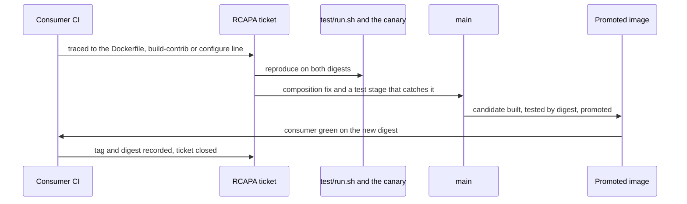

# RCAPA: regressions in a release of swarm-routing/ns3-containers

An **RCAPA** (root cause analysis with corrective and preventive actions) is
the full record of one **regression in a published library**: a version of
it that another project consumes (a release pinned by a lock, PyPI, a vcpkg
port) worked, and a later one broke. A bug or change that never reached a
published version needs none (an ordinary `bug` issue is enough), a Docker
image needs one only when its composition is the cause, and an upstream
ns-3 bug is an `NS3-NNN` in swarm-routing/ns3-tools. The org's rule and its decision table are in
[CONTRIBUTING.md, "RCAPA"](https://github.com/swarm-routing/.github/blob/main/CONTRIBUTING.md#rcapa)
([ADR-0003](https://github.com/swarm-routing/.github/blob/main/docs/adr/0003-rcapa-for-ns3-bugs-and-released-regressions.md)).
This page is the project's flow and its index.

## The flow for this project

This repository publishes **images**, the `ghcr.io/swarm-routing/ns3-dev`
tags. Images get **no RCAPA by default** (maintainer decision 2026-11-16): a
broken image, a failing test stage or a consumer that stops building on a new
image is an ordinary `bug` issue, and an upstream ns-3 bug met in an image is
an `NS3-NNN` in swarm-routing/ns3-tools. An RCAPA applies **only when the
defect is traced to the image's composition**: `docker/Dockerfile` and
what it copies into the image (`docker/scripts/build-contrib.sh`, that is
`ns3-build-contrib`; `docker/scripts/swarm-quality.cmake`;
`docker/gcovr-requirements.txt`), the shared configure line (golden rule 10)
or the base image digest. Then it is a `CNT-NNN` here,
the repository that owns the Dockerfile.

| | |
|---|---|
| Published as | promoted `ns3-dev` tags on ghcr.io; an RCAPA only for a defect in their composition (the Dockerfile and what it copies in: `build-contrib.sh`, `swarm-quality.cmake`, `gcovr-requirements.txt`; the configure line; the base image) |
| ID prefix | `CNT-NNN` |
| Ticket | an issue in swarm-routing/ns3-containers, form *Regression in a release (RCAPA)*, title `[rcapa] CNT-NNN <short description>`, labels `rcapa` and `bug`; name both images by tag **and** digest, and the composition change that caused it |
| Verified by | `docker pull` of both images by digest, then `test/run.sh` on the failing digest and the last good one (structure, profile, smoke with its Ninja step-count gate, integration, unit), and the downstream canary (`test/downstream.sh`, ubuntu debug only; a consumer outside its ns-3 range or without its module directory is skipped and named in the job log) |
| Corrective action | the composition fix; `publish-images.yml` builds a new candidate, tests it by digest and promotes it (golden rule 17) |
| Preventive action | a test stage or assertion in `test/` (structure, profile or smoke) that fails on the bad composition, so `promote` never copies it again |
| Closes when | a promoted image carries the fix (tag and digest recorded) **and** the check that found it is green on it: the consumer's build, or `test/run.sh` on the promoted digest when the image tests found it |

## Index

| ID | RCAPA | RCAPA ticket | Fixed in |
|----|-------|--------------|----------|

## Adding one: the ticket first

1. Open the RCAPA ticket (the table above). `NNN` is the next free number in
   the index.
2. Copy [`_template.md`](_template.md) to `rcapa-<short-description>.md`
   (lowercase, hyphens: what breaks, not where it was found), and add its row
   to the index in the same pull request.
3. The ticket stays open until a promoted image carries the fix and the check that found it (the consumer's build, or `test/run.sh`) is green on it; record the tag and digest in the index.

## What an RCAPA answers

1. **What broke, in which release, and who did it touch?** The symptom, the
   releases that fail and the last that passes, the users, numbers or
   downstream pins it affects.
2. **How do I see it myself?** Exact commands, the release or commit, an
   image by tag and digest when one is involved, seeds, expected against
   actual.
3. **Why did it happen, and why did our checks let it into a release?** Five
   whys, each citing its evidence: a source line at a named commit, a log, a
   run, a comment. An answer without a source is a hypothesis and says so.
4. **What does it look like?** Mermaid diagrams: the failing call chain, the
   types or components involved.
5. **What did we do about it?** Corrective actions (the fix, its PR, the
   release that carries it) and preventive actions (the test or check that
   catches a recurrence). An action not done yet is an open issue, linked.
6. **When?** A dated timeline and every link.

## Writing one

- Every issue and PR reference is fully qualified: `swarm-routing/<repo>#N`,
  also for this repository's own items; an ns-3 item is a link whose text is
  `nsnam/ns-3-dev#N` to its full gitlab.com URL. Never a bare number with a
  hash. In a mermaid block, which cannot hold a hash, name the item in words.
- Mermaid: no HTML entities inside a block; write template arguments as
  words.
- An RCAPA is never deleted. Later findings update its status and timeline.
